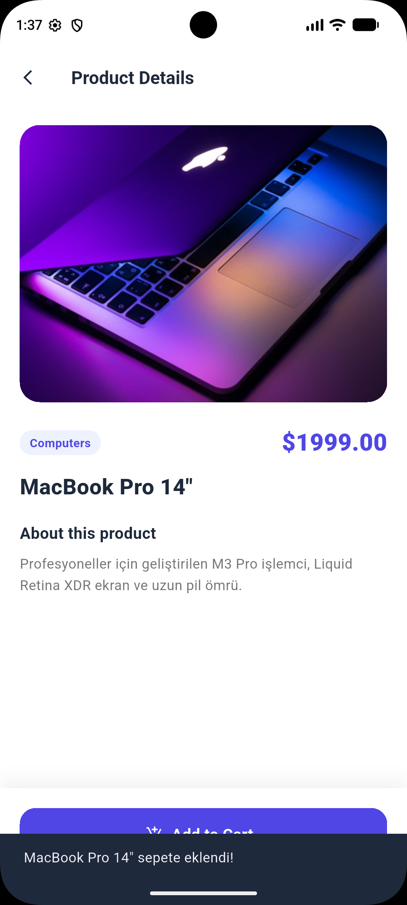
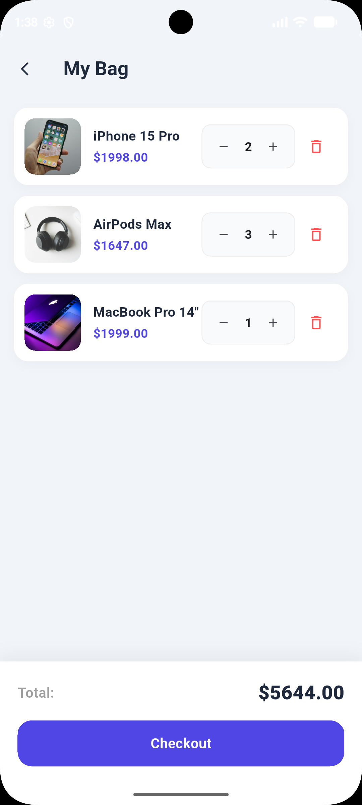
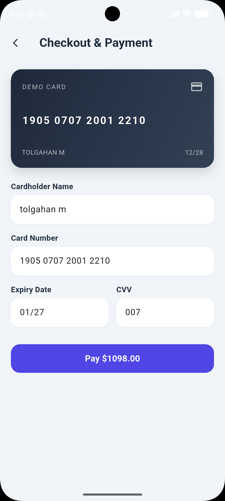
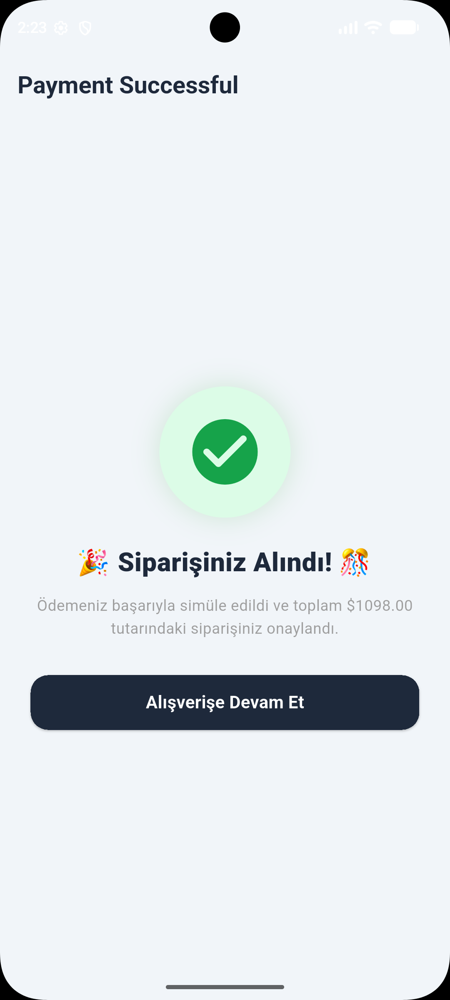

# Mini Katalog Uygulaması

Flutter temel eğitim haftası çıktısı olarak geliştirilmiş; yerel JSON asset entegrasyonu, dinamik sepet & adet yönetimi ve mock ödeme akışını içeren modern bir mobil katalog uygulaması.

---

## 🛠 Kullanılan Teknolojiler & Ortam
- **Flutter SDK:** 3.47.7 (Channel stable)
- **Dart SDK:** Entegre Dart SDK
- **Geliştirme Ortamı (IDE):** Visual Studio Code
- **Emülatör:** Android Studio Pixel Emulator (API 36)
- **Paketler:** Dış paket kullanılmamış, saf `material.dart` tercih edilmiştir.

---

## 📱 Temel Özellikler & Ekranlar
- **Keşfet (Discover):** Banner duyurusu, arama çubuğu, kategori bazlı filtreleme ve `GridView.builder` ile 2 sütunlu kart listeleme.
- **Asset & JSON Yönetimi:** Ürün verileri yerel `assets/products.json` dosyasından asenkron olarak okunmaktadır.
- **Ürün Detay Ekranı:** `Navigator` aracılığıyla seçilen modelin veri aktarımı ve sepete ekleme aksiyonu.
- **Sepet Yönetimi (My Bag):** Her ürün için adet artırma (`+`) ve azaltma (`-`), 0'a indiğinde sepetten çıkarma, ara toplamın dinamik hesaplanması ve boş sepet kontrolü.
- **Ödeme & Sipariş Simülasyonu (Checkout):** Kredi kartı formu, interaktif kart önizlemesi ve sipariş onay ekranı (başarı sonrası sepetin otomatik sıfırlanması).

---

## 🚀 Projeyi Yerelde Çalıştırma

```bash
# Repoyu klonlayın
git clone [https://github.com/mestan4/mini_katalog_app.git](https://github.com/mestan4/mini_katalog_app.git)

# Proje dizinine girin
cd mini_katalog_app

# Bağımlılıkları kontrol edin
flutter pub get

# Emülatör veya cihazda başlatın
flutter run
```

---

## 📸 Uygulama Ekran Görüntüleri

### Katalog & Sepet Akışı
| Ana Sayfa (Discover) | Ürün Detayı | Sepet (My Bag) |
| :---: | :---: | :---: |
|  |  |  |

### Ödeme & Sipariş Onay Akışı
| Ödeme Formu (Checkout) | Başarılı Sipariş Ekranı |
| :---: | :---: |
|  |  |